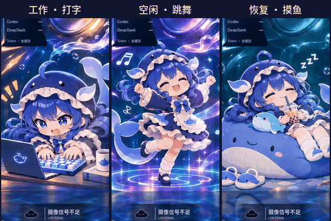
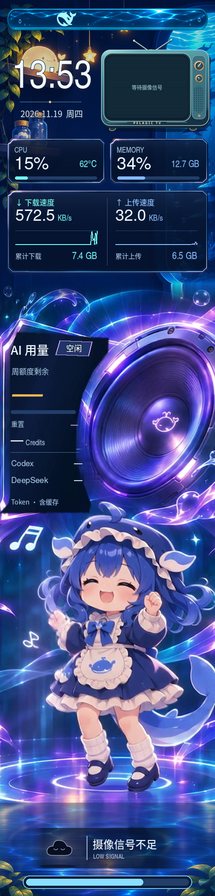
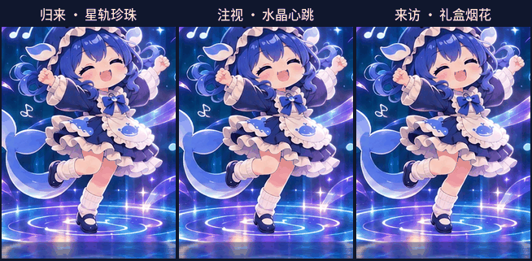

# 鲸娘桌面副屏 · MiraBox Whale Desk

把一块 **MiraBox D92 竖屏**变成会陪你工作的桌面鲸娘。Codex 或 DeepSeek Harness 忙起来，她就坐下飞快打字；任务结束，她回到舞台跳舞，累了就摸鱼。接上摄像头后，她还能认出主人、朝你打招呼，在有客人时替你看桌。



上图把三个模式的实际输出裁到同一舞台区域，方便看清动作。仓库包含三套动画的全部 **555 帧**、界面素材和中文招呼语音，克隆后即可预览。

## 一块屏上能看什么

<p align="center"><a href="docs/media/dashboard.png"></a></p>

这是程序按 **462 × 1920** 实际渲染的完整画面，点击可看原图。截图使用采样时的 CPU、内存和网络数据。拍摄文档时关闭了摄像头输入与个人账户读数，小电视因此显示等待信号。

| 位置 | 内容 |
| --- | --- |
| 顶部 | 小鲸鱼沿鱼缸指示当前分钟的进度，下面是日期、时钟和复古摄像头电视。 |
| 监控区 | CPU、温度、内存占用，上传和下载各自的速度曲线及开机累计流量。 |
| AI 用量 | 显示当前可读的 Codex 配额、重置倒计时、Credits，以及 Codex 和 DeepSeek 最近相关会话的 token 数。缺失值显示为「—」。 |
| 鲸娘舞台 | AI 工作优先打字；空闲时消耗体力跳舞。体力从 100 降至 20 约需 400 秒，休息约 16 秒即可回满。 |
| 底部 | 主人朝向、离席或访客状态，以及鲸娘体力槽。 |

## 它怎么跟人互动

- **看向副机**：认出主人并检测到正脸，底部显示「主人在看我」。侧向主力电脑的姿势稳定后，切到「主人在工作」。朝向来自面部特征点，是姿势估计。
- **主人离席**：先说明镜头里是「未见人脸」「未认出主人」还是「仅见访客」。清晰、安静的空画面持续约半分钟后才确认离席。主人回来只招呼一次。
- **有人来访**：主人与另一张独立的人脸同框时，直接给对方标上「陌生人」。访客停留时轮播竖排彩色弹幕。机灵少女音色按主人在场、离席和状态待定分别抽取台词。首次见客与后续轮播共用本场景的进度，短暂走出镜头再回来也能听到新句子。
- **舞台礼物**：主人回来时升起星轨珍珠，看向镜头时触发水晶心跳，客人初次来访时弹开礼盒。礼物在舞台下半部播放约 4.4 秒。



## 配音、切换与弹幕去重

| 音色 | 主人互动及访客招呼 | 访客持续停留 |
| --- | --- | --- |
| 机灵少女 · 俏皮萌妹 | 24 条配音 | 新增 152 条配音，每句按自己的录音时长同步字幕。礼盒只在首次招呼时出现。 |
| 原配音 · 柔和少女 | 保留原来的 24 条配音 | 访客停留时继续用文字轮播。 |

机灵少女使用随仓库提供的 **176 个 WAV**，无需在线合成。可试听[机灵少女版的回家问候](maid-voice/voices/playful/clips/return-0.wav)和[同一句的原配音](maid-voice/clips/return-0.wav)。

在仓库根目录运行以下任一命令。切换从下一句播报生效。首次安装且尚未选择时使用原配音。

```bash
python3 maid-voice/choose-voice.py playful    # 机灵少女，全弹幕配音
python3 maid-voice/choose-voice.py original   # 切回原配音
python3 maid-voice/choose-voice.py --status   # 查看当前音色
```

安装 Zenity 后，直接运行 `python3 maid-voice/choose-voice.py` 可打开图形选择器。要在应用菜单搜索「鲸娘配音切换」，可把该脚本以 `whale-voice` 为名链接到桌面会话 PATH 中的目录，再将 `maid-voice/whale-voice.desktop` 放入 `~/.local/share/applications/`。

**哪些弹幕会重复？** 机灵少女的访客弹幕有三组：主人在场 67 句（3 句招呼 + 64 句轮播）、主人离席 67 句、状态待定 27 句。每组独立随机抽取，一轮内每句只出现一次；换轮后也避开这个场景最近的 8 句。抽取进度保存在本机，跨访客、跨状态切换和重启延续。旧版分开保存的招呼与轮播进度会在首次合并时接续。

主人对视和工作各有 4 句专属配音，场景内同样先播完整轮。频繁转头时，同一种姿态的播报至少相隔 75 秒；底部主人状态仍随识别更新。确认主人离席或主人返回后，主人姿态的冷却重新计算。

## 先在电脑上预览

以下命令适用于使用 APT 的 Linux 桌面。渲染端使用系统 Python，方便加载 GTK 的 SVG 绑定与中文字体。预览可在没有副屏或摄像头的情况下运行。

```bash
git clone https://github.com/zard110/mirabox-whale-desk.git
cd mirabox-whale-desk
sudo apt install python3-pil python3-psutil python3-gi gir1.2-rsvg-2.0 fonts-noto-cjk fonts-urw-base35
/usr/bin/python3 versions/storm-c11/dashboard.py --preview preview.png --mode dancing
```

把 `dancing` 换成 `typing` 或 `slacking` 即可预览另两种状态。要重新生成文档里的完整截图和三态动图，可运行 `/usr/bin/python3 scripts/capture-demo.py`。

## 接入 USB 副屏

实机验证的设备是 **MiraBox D92**，USB 标识为 `5548:1011`，通过 Linux `hidraw` 输出 JPEG 全帧与局部更新。目标为每秒 24 帧，发送时按当前竖装方向旋转 180°。其他型号是否兼容，要看输出报告与分辨率。

先用 `lsusb -d 5548:1011` 确认设备。如果当前桌面用户没有读写权限，可安装以下 udev 规则，再重新插拔 D92。

```bash
echo 'SUBSYSTEM=="hidraw", ATTRS{idVendor}=="5548", ATTRS{idProduct}=="1011", TAG+="uaccess"' | sudo tee /etc/udev/rules.d/70-mirabox-d92.rules
sudo udevadm control --reload-rules
```

以普通用户身份运行，按 Ctrl+C 停止。多块同型号副屏同时连接时，用环境变量 `MIRABOX_SERIAL` 指定目标设备的实际序列号。

```bash
/usr/bin/python3 versions/storm-c11/dashboard.py
```

## 可选：让鲸娘认出你

另开一个终端，进入同一仓库目录。识别端使用独立的 Python 虚拟环境和 OpenCV 的 YuNet、SFace 模型。下载脚本固定模型版本并检查 SHA-256。请使用自己或同意参与者的摄像头。

```bash
sudo apt install python3-venv libnotify-bin pipewire-bin curl
python3 -m venv .venv
.venv/bin/pip install 'opencv-python-headless>=4.10,<5' numpy
./scripts/get-models.sh
.venv/bin/python presence/whale.py enroll
.venv/bin/python presence/whale.py watch
```

录入时独自正对镜头，保持几秒并轻轻转头。默认设备为 `/dev/video0`，也可以在录入和识别前先运行 `export WHALE_CAMERA=/dev/video2`。让 `watch` 和副屏程序在同一用户会话内运行，小电视就会接收实时画面；语音由 PipeWire 的 `pw-play` 播放。

摄像帧仅经本机 Unix 套接字发送到副屏。运行期间的人脸特征、在场状态、欢迎事件和弹幕进度位于 `~/.local/state/whale-presence/`；体力和用量缓存位于 `~/.local/state/mirabox-d92/`。停止识别后，可删除前一目录里的 `owner.npy` 和 `owner-side.npy` 清除录入的特征。

模型来源与许可见 [OpenCV Zoo · YuNet](https://github.com/opencv/opencv_zoo/tree/48b10fa505aeb51fbd127fc60a5c660040e823b7/models/face_detection_yunet) 和 [OpenCV Zoo · SFace](https://github.com/opencv/opencv_zoo/tree/48b10fa505aeb51fbd127fc60a5c660040e823b7/models/face_recognition_sface)。

## AI 活动和用量从哪里来

程序检查本机 Codex 的任务状态、最近会话的 token 元数据，以及 DeepSeek Harness 的会话锁与进行中轮次。额度来自已有会话快照，或本机已登录的 `codex app-server`。没有安装这些工具时，时钟、硬件监控和空闲舞台仍可使用。工具升级若改变本地数据库或缓存结构，对应读数可能暂时缺失。

## 代码和验证

| 路径 | 用途 |
| --- | --- |
| `versions/storm-c11/` | HID 输出、分层渲染、三态动画、AI 活动与用量检测 |
| `versions/storm-c11/gifts.py` | 珍珠轨道、心形粒子、礼盒与舞台光效 |
| `presence/` | 摄像头录入、身份和朝向判断、访客跟踪、离席确认 |
| `maid-voice/` | 台词、语音片段、弹幕时序与不重复轮播词库 |
| `docs/media/` | README 使用的截图和 GIF |

```bash
/usr/bin/python3 -m unittest discover -s versions/storm-c11 -v
# 安装识别环境并下载模型后运行
.venv/bin/python -m unittest discover -s presence -v
```
